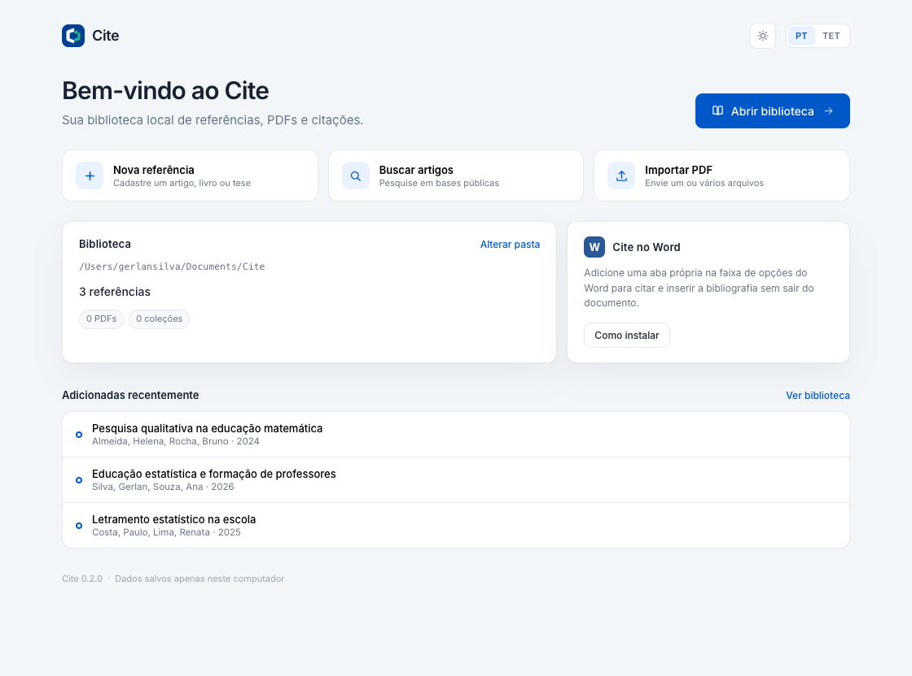
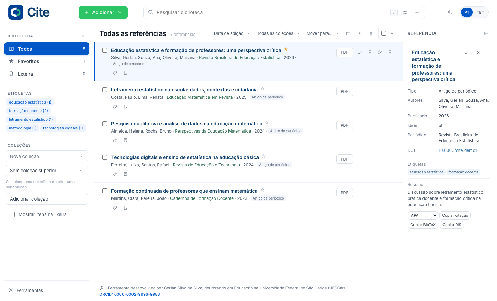
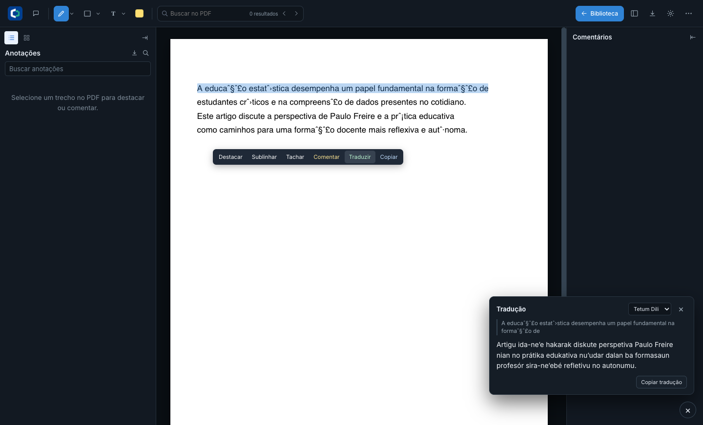
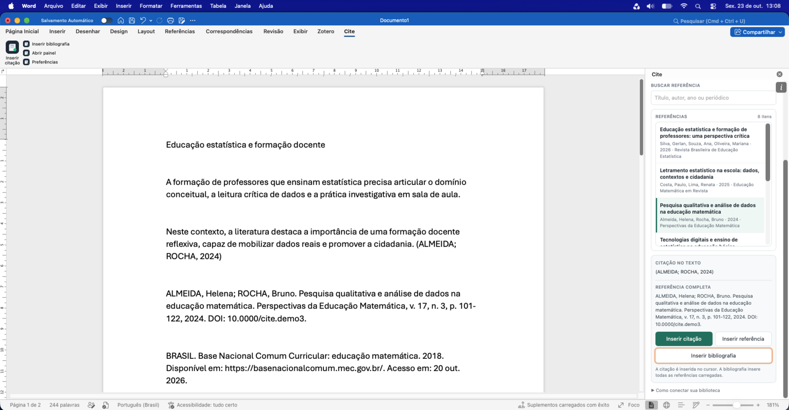

# Cite

Gerenciador de referências local para macOS e Windows, inspirado no Paperpile. O Cite organiza a biblioteca, importa metadados, pesquisa artigos online, abre PDFs com anotações e publica a bibliografia em um repositório GitHub.

Versão atual: **0.2.0**.

## Interface

### Tela inicial



Ao abrir, o Cite mostra a tela inicial com o resumo da biblioteca, as referências adicionadas recentemente e atalhos para criar uma referência, buscar artigos ou importar um PDF. O menu **Arquivo > Início** reabre essa tela, e **Abrir biblioteca** leva à lista completa.

### Biblioteca



### Leitura de PDF e tradução



## Integração com Word



O add-in cria uma aba **Cite** na faixa de opções do Word, no estilo da aba do Zotero. A aba tem os botões **Inserir citação**, **Inserir bibliografia** e **Abrir painel**, além do menu **Mais** com **Preferências do documento**, **Atualizar citações** e **Desvincular citações**. O painel se conecta à biblioteca local pelo próprio aplicativo, sem publicar nada no GitHub.

As citações e a bibliografia são inseridas como campos vinculados do Cite. Selecione uma ou mais referências para combiná-las na mesma chamada e use **Opções da citação** para página, prefixo, sufixo, apud, citação narrativa, omissão de autor/ano e complemento do ano. A bibliografia contém apenas as referências citadas no documento e acompanha as citações: ao remover uma citação, a referência sai da lista. Ao trocar o estilo ou atualizar a biblioteca, use **Atualizar citações** para reformatar o documento inteiro. **Desvincular citações** converte os campos em texto comum.

O Cite serve o painel e a API em `https://localhost:23120` com um certificado local. Na tela inicial, o cartão **Cite no Word** instala o certificado no chaveiro do sistema, copia o manifesto para a pasta `wef` do Word e inicia o painel. Depois é só reiniciar o Word e abrir **Página Inicial → Suplementos → Cite**.

A conexão é local e offline: o painel busca as referências direto da biblioteca aberta no Cite. Se o aplicativo estiver fechado, o painel oferece o modo alternativo com o `bibliography.json` publicado.

No macOS, o Word não mantém add-ins locais fixos na faixa de opções entre sessões. Se a aba **Cite** não estiver visível ao reabrir o Word, clique em **Página Inicial → Suplementos → Cite**. As instruções completas estão em [integrations/word/README.md](integrations/word/README.md).

## Recursos

- Tela inicial com resumo da biblioteca, referências recentes e ações rápidas.
- Biblioteca local com favoritos, lixeira, coleções, etiquetas e busca.
- Importação de BibTeX e RIS; exportação de BibTeX, RIS, Markdown e CSV.
- Citações em ABNT, APA, MLA, Harvard, Vancouver e Chicago.
- Busca online em Crossref, arXiv, PubMed e Google Acadêmico.
- Paginação de resultados com **Carregar mais**.
- Download de PDFs de acesso aberto via OpenAlex.
- Visualizador de PDF com pdf.js:
  - destaque, sublinhado e tachado;
  - comentários e anotações por página;
  - busca, zoom, rotação e cópia com número da página;
  - tema claro e escuro;
  - tradução de trechos para português, inglês, espanhol e **Tetum Dili**.
- Add-in do Microsoft Word com aba própria e conexão local por HTTPS.
- Citações e bibliografia vinculadas ao Cite, com atualização e desvinculação pelo Word.
- Publicação opcional de `bibliography.json` no GitHub.
- Add-in do Google Docs em [`integrations/`](integrations/).
- Backup e restauração da biblioteca.
- Interface em português e Tetum.

## Instalação

### macOS

1. Abra `Cite-0.2.0-arm64.dmg`.
2. Arraste o **Cite** para a pasta **Aplicativos**.
3. Abra o aplicativo.

O build não é assinado. Se o macOS bloquear a abertura, use **Abrir** pelo menu de contexto ou autorize o aplicativo em **Ajustes do Sistema > Privacidade e Segurança**.

### Windows

1. Execute `Cite-Setup-0.2.0.exe`.
2. Siga as telas do assistente: boas-vindas, pasta de instalação, instalação e conclusão.
3. Ao final, o Cite pode ser aberto imediatamente.

O instalador é x64 e instala por usuário em `%LOCALAPPDATA%\Programs\Cite`, sem exigir administrador. Ele cria atalhos na Área de Trabalho e no Menu Iniciar e registra o desinstalador em **Configurações > Aplicativos**.

O build não tem certificado digital. O Windows pode exibir o aviso do SmartScreen; nesse caso, use **Mais informações > Executar assim mesmo**.

### Primeiro uso

Na primeira execução, o Cite cria automaticamente a biblioteca em `~/Documents/Cite` e abre a tela inicial, pronta para receber a primeira referência. Nenhum projeto precisa ser criado.

O caminho fica registrado em:

- macOS: `~/Library/Application Support/Cite/storage.json`
- Windows: `%APPDATA%\Cite\storage.json`

Se a pasta configurada for excluída, movida ou ficar sem permissão de escrita, o Cite abre uma tela de recuperação com o caminho anterior e duas opções: usar a biblioteca padrão ou escolher outra pasta. A tela não tenta abrir a biblioteca ausente nem gera erro.

## Desenvolvimento

### Requisitos

- Node.js 20 ou superior
- npm
- macOS ou Windows

### Executar a partir do código

```bash
npm ci
npm run build:viewer
npm start
```

`npm run build:viewer` gera os bundles do visualizador de PDF e do worker do pdf.js. Execute esse comando após alterar arquivos em `src/pdf-viewer.js` ou `src/pdf-text.js`.

### Testes

```bash
npx playwright test
npm run test:data
```

Os testes Playwright cobrem biblioteca, busca online, visualizador, PDF, tema, tradução, armazenamento e ferramentas. Os testes de dados usam o runner nativo do Node.js.

## Build

### macOS

```bash
npx electron-builder --mac dmg
```

Saída: `dist/Cite-0.2.0-arm64.dmg`.

### Windows

```bash
npm run build:win
```

O comando:

1. gera os bundles do visualizador;
2. empacota o aplicativo Windows x64 em `dist/win-unpacked`;
3. aplica ícone e informações de versão no executável;
4. compila o instalador NSIS com as telas padrão.

Saída: `dist/Cite-Setup-0.2.0.exe`.

O build Windows requer o compilador **makensis**:

- macOS: `brew install makensis`
- Windows: instale o NSIS e deixe `makensis` no `PATH`

Também é possível definir o caminho manualmente:

```bash
MAKENSIS=/caminho/para/makensis npm run build:win
```

Os arquivos de `dist/` não são versionados. Distribua-os como anexos de uma release do GitHub; o DMG tem cerca de 118 MB e o instalador Windows cerca de 95 MB.

## Estrutura do projeto

```text
main.js                     processo principal do Electron
preload.js                  ponte segura entre renderer e main
storage.js                  armazenamento de anexos
src/ui.html, src/ui.js      biblioteca e interface principal
src/pdf-viewer.html/.js     visualizador de PDF
src/pdf-text.js             extração de texto do PDF
src/data-worker.js          worker de dados
src/data/db.js              banco IndexedDB com Dexie
src/*.js                    citações, importação, exportação e utilitários
integrations/               add-ins para Word e Google Docs
scripts/                    build e instalador do Windows
build/                      ícones do aplicativo
tests/                      testes Playwright e testes de dados
```

## Dados e privacidade

- A biblioteca é local; o Cite não mantém um servidor próprio.
- A biblioteca padrão fica em `~/Documents/Cite`; o usuário pode escolher outra pasta na tela de recuperação.
- Anexos são armazenados na subpasta `attachments` da pasta da biblioteca.
- A busca online envia consultas aos provedores escolhidos.
- A tradução envia apenas o trecho selecionado ao serviço de tradução configurado. O padrão é o endpoint web do Google Translate.
- A publicação no GitHub usa um token salvo com o `safeStorage` do Electron e envia a bibliografia ao repositório indicado pelo usuário.
- Não há telemetria nem analytics.

## Limitações conhecidas

- Os builds são não assinados; macOS Gatekeeper e Windows SmartScreen podem exibir avisos.
- O instalador Windows é x64.
- Não há sincronização automática entre computadores; a bibliografia pode ser publicada no GitHub e os dados podem ser copiados manualmente.
- O download de PDFs prioriza acesso aberto. O Cite não contorna paywalls.
- A tradução depende de um serviço externo e de conexão com a internet.
- A licença do projeto ainda não foi definida. Antes de tornar o repositório público, escolha uma licença adequada.

## Documentação adicional

- [Instalação e distribuição](docs/INSTALACAO.md)
- [Desenvolvimento e arquitetura](docs/DESENVOLVIMENTO.md)
- [Publicação no GitHub](docs/PUBLICACAO.md)
- [Histórico de mudanças](CHANGELOG.md)
