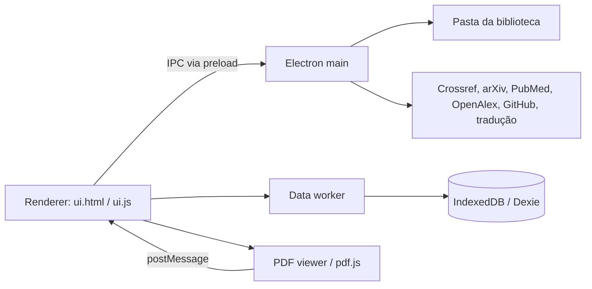

# Desenvolvimento e arquitetura

## Visão geral

O Cite é um aplicativo Electron com interface em HTML, CSS e JavaScript puro. Não há framework de UI. O processo principal concentra acesso ao sistema de arquivos, rede e janelas; o renderer acessa esses recursos apenas pelo `preload.js`, com `contextIsolation` e `sandbox` ativados.



## Processos e responsabilidades

### `main.js`

- cria a janela principal;
- gerencia a pasta de armazenamento e a migração de dados legados;
- executa chamadas de rede que precisam evitar CORS ou proteger credenciais;
- implementa busca online, DOI, metadados, download de PDF e tradução;
- publica a bibliografia no GitHub;
- constrói o menu nativo, com variantes para macOS e Windows.

### `preload.js`

Expõe uma API pequena em `window.cite`, incluindo dados, DOI, tradução, metadados, PDF, backup, anotações, configurações e integrações. O renderer não recebe acesso direto ao Node.js.

### `src/ui.js`

Controla a biblioteca, coleções, etiquetas, filtros, busca online, detalhes, citações, importação/exportação e o ciclo de vida do visualizador. Também faz a ponte por `postMessage` com o iframe do PDF.

### `src/pdf-viewer.js`

Carrega o PDF com pdf.js, renderiza páginas e a camada de texto, controla ferramentas de anotação, comentários, busca interna, zoom, rotação, temas e tradução por seleção.

### `src/data-worker.js` e `src/data/db.js`

O worker mantém o banco IndexedDB com Dexie. As principais coleções são `Library`, `Attachments`, `Collections`, `Notes`, `Changes`, `LocalSettings` e `Files`. O nome interno do banco permanece `refdesk` para preservar bibliotecas antigas.

## Fluxo de dados

1. No primeiro uso, o `main.js` cria a biblioteca padrão em `~/Documents/Cite` e grava o caminho em `storage.json`.
2. O `main.js` redefine `userData` para essa pasta; o worker abre o IndexedDB e atende chamadas de leitura e escrita.
3. Anexos são salvos em `attachments`, com hash SHA-256 para deduplicação.
4. A interface renderiza a biblioteca a partir do worker, inclusive quando ela está vazia.

### Recuperação da biblioteca

`prepareStorage()` valida a pasta configurada antes de criar qualquer janela de dados. Se a pasta não existir, não for um diretório ou não permitir escrita, ele preenche `storageSetup` e o app abre `src/setup.html` em vez da biblioteca. A tela recebe o estado pelo IPC `storage:setup:state` e oferece:

- `storage:setup:default`: cria ou reutiliza a biblioteca padrão.
- `storage:setup:choose`: abre o seletor nativo de pastas.
- `storage:setup:quit`: encerra o aplicativo.

Depois de configurar, o app grava `storage.json` e reinicia para abrir a biblioteca. Nenhum módulo de dados é carregado enquanto a pasta estiver inacessível, então uma biblioteca excluída não gera erro na inicialização.

Para testes, `CITE_STORAGE_CONFIG` aponta para um `storage.json` alternativo, `CITE_DEFAULT_STORAGE_DIR` troca a biblioteca padrão e `CITE_FORCE_STORAGE_SETUP=1` executa `prepareStorage()` mesmo com `--user-data-dir`.

## Tela inicial

`src/home.html` é a primeira janela do aplicativo. Ela lê os dados pelo mesmo worker (`library:all`, `attachments:all`, `collections:all`), mostra totais, caminho da biblioteca e as últimas referências, e oferece ações rápidas.

O IPC `home:open` cria a janela da biblioteca com um parâmetro de ação:

- `?action=new` abre o formulário de nova referência.
- `?action=search` abre a busca online.
- `?action=import` abre o seletor de PDFs.
- `?focus=<id>` seleciona uma referência.

A janela inicial é fechada ao abrir a biblioteca. O item **Arquivo > Início** (`open-home`) reabre a tela inicial, e `CITE_SKIP_HOME=1` inicia direto na biblioteca, usado pelos testes que não exercitam a tela inicial.

O botão **Alterar pasta** grava um novo `storage.json` e reinicia o app. Se a pasta escolhida ainda estiver vazia, o app confirma antes de criar uma biblioteca nova ali; os dados da pasta anterior continuam intactos. Se a pasta já tiver uma biblioteca, ela é apenas aberta.

## Busca online e PDFs

- Crossref usa `offset` para paginação.
- arXiv usa `start`.
- PubMed usa `retstart`.
- Google Acadêmico usa `start`.
- Metadados são normalizados antes de serem anexados à lista de resultados.
- O download de PDF prioriza links de acesso aberto, incluindo OpenAlex, e valida o conteúdo antes de anexar.

## Visualizador de PDF

O visualizador roda em um iframe e usa:

- `pdfjs-dist` para renderização e camada de texto;
- `pdf-text.bundle.js` para extração de texto;
- `pdf.worker.bundle.js` como worker;
- `postMessage` para pedir anotações, atualizar notas, abrir links externos e traduzir.

A seleção de texto gera um menu flutuante com destaque, sublinhado, tachado, comentário, tradução e cópia com número da página.

## Add-in do Word

O add-in fica em `integrations/word` e usa o manifesto XML de task pane com `VersionOverrides` para criar a aba **Cite**. Os botões **Inserir citação**, **Inserir bibliografia** e **Abrir painel** usam `ShowTaskpane`; o menu **Mais** reúne **Preferências do documento** (`ShowTaskpane`) e os comandos `ExecuteFunction` **Atualizar citações** e **Desvincular citações**. O `commands.html` é o `FunctionFile` e carrega `fields.js` antes de `commands.js`.

- `manifest.xml`: produção, com placeholders de usuário/repositório.
- `manifest.local-server.xml`: manifesto local com `__PORT__`, usado pelo conector do aplicativo.
- `manifest.localhost.xml`: desenvolvimento local em `https://localhost:3000`.
- `taskpane.html/js`: busca, prévia, estilos, conexão local, cartão do documento e inserção no documento.
- `fields.js`: formatação autor-data/referência e content controls `cite:citation:<ids>` e `cite:bibliography`; expõe `window.CiteFields`.
- `commands.js`: implementa `refreshCitations` e `unlinkCitations` via `Office.actions.associate`.
- `demo-bibliography.json`: bibliografia fictícia para demonstração.
- `word-addin.js`: certificado, confiança, manifesto e instalação.
- `connector.js`: servidor HTTPS local com `/ping`, `/library`, `/fields.js` e arquivos do painel.
- `scripts/serve-word-addin.js`: servidor HTTPS isolado para desenvolver o add-in.

### Conector local

O Word no macOS usa WebKit e bloqueia requisições HTTP para `127.0.0.1` a partir de uma página HTTPS. Por isso o aplicativo serve o painel e a API no mesmo host HTTPS:

```text
https://localhost:23120/taskpane.html   painel
https://localhost:23120/ping            identificação e caminho da biblioteca
https://localhost:23120/library         bibliografia completa
```

O certificado é gerado com `selfsigned`, com `CA:TRUE` e SAN para `localhost` e `127.0.0.1`. No macOS, a confiança usa `security add-trusted-cert`; no Windows, `certutil -addstore -user Root`. A porta padrão é 23120, com tentativa até 23129. Se a porta mudar, o manifesto é reescrito.

A instalação grava o estado em `~/Library/Application Support/Cite/word-addin/install.json` e o certificado em `tls/`. O manifesto é copiado para `~/Library/Containers/com.microsoft.Word/Data/Documents/wef/cite-word.xml`.

Para desenvolver com recarga do aplicativo:

```bash
npm start
```

O painel fica em `https://localhost:23120/taskpane.html`. O servidor isolado do add-in continua disponível com `npm run word:serve`.

Testes:

```bash
node --test tests/word-addin.test.js tests/word-fields.test.js
npx playwright test tests/word-addin.spec.ts
```

Os testes de instalação usam `CITE_WORD_WEF_DIR`, `CITE_WORD_ADDIN_DIR`, `CITE_WORD_TRUST=skip` e `CITE_WORD_PORT` para não tocar na instalação real. Os testes de campos rodam `fields.js` em um sandbox `vm` com um mock de `Word.run`, cobrindo inserção, edição da citação sob o cursor, atualização e desvinculação de content controls.

O painel usa `Word.run` e `context.document.getSelection()` para inserir ou substituir citações. Cada citação vira um content control com a etiqueta `cite:citation:<token>` e a bibliografia usa `cite:bibliography`. `refreshDocument` percorre `context.document.contentControls`, reformata os campos e é chamado pelo painel e por `commands.js`. `unlinkDocument` remove os content controls mantendo o texto.

O token é curto e aponta para os metadados da citação — ids das referências e opções (prefixo, página, sufixo, complemento do ano, apud, narrativa e omissões) — guardados em `Office.context.document.settings` e persistidos com `saveAsync`. O token evita o limite de tamanho da etiqueta e permite várias citações com opções diferentes. `citationRef` aceita etiquetas antigas com ids separados por vírgula, então documentos já criados continuam atualizáveis.

Os estilos autor-data são formatados em `citationText`, com regras próprias para ABNT, APA, MLA, Harvard e Chicago e suporte a múltiplas referências, página, sufixo e apud. Vancouver é numérico: `citationNumbers` percorre as etiquetas na ordem do documento, atribui `1..n` na primeira aparição e alimenta tanto as citações quanto a bibliografia numerada. A bibliografia é criada em parágrafos próprios ao final do corpo, sem envolver o conteúdo existente. `citedIdsFromControls` extrai as referências efetivamente citadas, então a bibliografia contém apenas esses itens; `syncBibliography` atualiza a lista sem reformatar as citações e é chamado pelo painel ao ganhar foco, em um intervalo de 15 segundos e pelos eventos `onDataChanged`/`onDeleted` dos content controls (WordApi 1.5), registrados por `watchCitations`.

## Idioma dos add-ins

O conector responde em `/ping` com `language` (`pt` ou `tet`), lido de `I18n.getLanguage()` no processo principal; o IPC `settings:set-language` atualiza esse valor quando o idioma muda no aplicativo. O painel do Word carrega `integrations/word/strings.js`, aplica `setLanguage`/`t` e localiza o HTML estático com `localize`, que guarda o texto original para permitir voltar ao português sem recarregar a página. Os elementos com `data-no-i18n` (lista, prévias, contagens e status) são renderizados com `t()` para não traduzir títulos de referências. O painel do Google Docs mantém um dicionário próprio no `Sidebar.html`, porque o Apps Script não acessa o conector local, e persiste a escolha em `CITE_LANGUAGE` nas propriedades do documento via `Code.gs`. Citações com texto vazio são removidas nessa sincronização. `tests/word-fields.test.js` cobre a matriz de estilos e autores, opções, múltiplas referências, inserção, atualização e desvinculação com um mock de `Word.run`; `tests/citations.test.js` cobre os seis estilos em todos os tipos de referência.

## Tradução

O trecho selecionado é normalizado, enviado pelo renderer ao processo principal e traduzido por um endpoint configurável. O padrão é o endpoint web do Google Translate. O limite é de 5.000 caracteres por trecho.

Destinos disponíveis na interface:

- Português
- Tetum Dili
- English
- Español

O painel de tradução fecha ao clicar fora e com `Esc`.

## Testes

```bash
npx playwright test
npm run test:data
```

Os testes Playwright usam um servidor mock para Crossref, Google Acadêmico, tradução e outras rotas. `tests/setup.spec.ts` cobre a primeira execução e a biblioteca excluída. Os testes de dados usam `node:test`.

## Build

### macOS

```bash
npx electron-builder --mac dmg
```

### Windows

```bash
npm run build:win
```

O script `scripts/build-windows-installer.js`:

- empacota `dist/win-unpacked` com `electron-builder`;
- usa `scripts/set-windows-resources.mjs` para aplicar ícone e versão com `resedit`;
- compila `scripts/windows-installer.nsi` com `makensis`.

O instalador usa NSIS e quatro telas padrão: boas-vindas, diretório, instalação e conclusão.

## Convenções

- Interface em português; traduções PT/TET em `src/i18n.js`.
- Não adicionar segredos ao repositório.
- Não versionar `node_modules/`, `dist/`, `test-results/` ou artefatos de build.
- Antes de abrir um pull request, execute os testes e o build da plataforma afetada.
