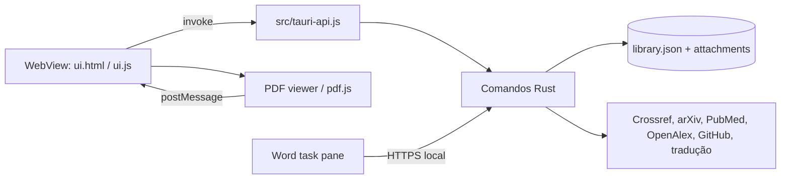

# Desenvolvimento e arquitetura

## Visão geral

O Cite é um aplicativo [Tauri 2](https://tauri.app) com interface em HTML, CSS e JavaScript puro. Não há framework de UI nem bundler para a interface: o Tauri serve os arquivos de `src/` diretamente (`frontendDist: ../src`). O backend é escrito em Rust e concentra acesso ao sistema de arquivos, rede, janelas, menus e o servidor local do Word. A interface acessa esses recursos apenas por comandos Tauri, expostos em `window.cite` por `src/tauri-api.js`.



## Backend Rust

### `src-tauri/src/lib.rs`

Registra os comandos Tauri, monta o estado compartilhado, abre a janela inicial ou a tela de recuperação, instala o menu e trata os eventos de ciclo de vida (`RunEvent`).

### `state.rs`

Resolve os diretórios do aplicativo, lê e grava `storage.json`, valida a pasta da biblioteca e monta o estado de recuperação (`setup issues`). A pasta padrão é `~/Documents/Cite`.

### `store.rs`

Substitui o IndexedDB/Dexie da versão Electron por um arquivo JSON (`library.json`) dentro da pasta da biblioteca. Mantém as tabelas `Library`, `Attachments`, `Collections`, `Notes`, `Changes`, `LocalSettings` e `Files`, com gravação atômica. Bibliotecas antigas chegam pelo backup `.json.gz`. Os métodos `data:*` são expostos por um único comando `data_call`.

### `attachments.rs`

Copia PDFs para `attachments/`, calcula hash SHA-256 para deduplicação, lê bytes para o visualizador e abre arquivos no aplicativo padrão do sistema.

### `net.rs`

Busca online (Crossref, arXiv, PubMed e Google Acadêmico), resolução de DOI, atualização de metadados, download de PDFs de acesso aberto via OpenAlex, metadados de páginas HTML e tradução. A rede fica no processo Rust para evitar CORS e manter as credenciais fora da WebView.

### `github.rs`

Publica `bibliography.json` no repositório configurado. O token é guardado no chaveiro do sistema (`keyring`); quando o chaveiro não está disponível, o token é gravado em base64 com o prefixo `plain:` no arquivo de integrações.

### `backup.rs`

Cria e restaura backups `.json.gz` compatíveis com a versão Electron: `{version, createdAt, data: {tables}, attachments}` com anexos em base64.

### `word.rs`

Servidor HTTPS local do add-in do Word, disponível no macOS. Gera o certificado com `rcgen`, confia nele pelo sistema (`security`), copia o manifesto para a pasta `wef`, responde a `/ping`, `/library`, `/fields.js` e aos arquivos do painel, e tenta portas de 23120 a 23129. No Windows o recurso responde como não suportado, igual à versão Electron.

### `citations.rs` e `bibtex.rs`

Formatação de citações nos seis estilos e serialização BibTeX. São usados pelo add-in do Word (`/library`) e pelos testes.

### `windows.rs` e `menu.rs`

Criam as janelas `home`, `library` e `setup` e instalam o menu nativo, com variantes para macOS e Windows. A janela da biblioteca desativa o handler nativo de drag-and-drop para que o HTML5 drag-and-drop da interface funcione.

## Ponte JavaScript

`src/tauri-api.js` expõe `window.cite` (e o alias `window.refdesk`) com os mesmos nomes usados pela versão Electron: `data.call`, `attachments`, `metadata`, `translation`, `backup`, `integrations.github`, `word`, `settings`, `files` e `shell`. Cada método chama `invoke` de um comando Tauri.

## Fluxo de dados

1. No primeiro uso, o backend cria a biblioteca padrão em `~/Documents/Cite` e grava o caminho em `storage.json`.
2. `store.rs` abre `library.json`, cria as tabelas ausentes e atende leituras e escritas.
3. Anexos ficam em `attachments/`, com hash SHA-256 para deduplicação.
4. A interface renderiza a biblioteca com os dados retornados por `data_call`.

### Recuperação da biblioteca

Antes de abrir qualquer janela de dados, o backend valida a pasta configurada. Se ela não existir, não for um diretório ou não permitir escrita, o aplicativo abre `src/setup.html`. A tela oferece usar a biblioteca padrão, escolher outra pasta ou encerrar. Nenhum comando de dados é executado enquanto a pasta estiver inacessível.

### Variáveis de ambiente

Úteis para testes e desenvolvimento:

- `CITE_STORAGE_CONFIG`: caminho alternativo do `storage.json`.
- `CITE_STORAGE_DIR`: abre a biblioteca na pasta indicada.
- `CITE_DEFAULT_STORAGE_DIR`: troca a biblioteca padrão.
- `CITE_SKIP_HOME=1`: inicia direto na biblioteca.
- `CITE_DISABLE_WORD=1`: desativa a integração com o Word.
- `CITE_WORD_ADDIN_DIR`, `CITE_WORD_WEF_DIR`, `CITE_WORD_TRUST`, `CITE_WORD_PORT`: controlam a instalação do add-in.
- `CITE_BACKUP_PATH`, `CITE_RESTORE_PATH`, `CITE_EXPORT_PATH`: caminhos fixos para testes de arquivo.
- `CITE_*_URL`: sobrescrevem endpoints de busca, tradução e PDF.
- `CITE_NO_OPEN=1`: impede abrir janelas externas.

## Tela inicial

`src/home.html` é a primeira janela. Ela consulta `library:all`, `attachments:all` e `collections:all`, mostra totais, caminho da biblioteca e as últimas referências, e oferece ações rápidas. A janela da biblioteca é criada com parâmetros de ação (`?action=new`, `?action=search`, `?action=import`, `?focus=<id>`). A tela inicial é fechada ao abrir a biblioteca; **Arquivo > Início** reabre.

## Busca online e PDFs

- Crossref usa `offset` para paginação; arXiv usa `start`; PubMed usa `retstart`; Google Acadêmico usa `start`.
- Metadados são normalizados antes de serem anexados à lista de resultados.
- O download de PDF prioriza links de acesso aberto, incluindo OpenAlex, e valida o conteúdo antes de anexar.

## Visualizador de PDF

O visualizador roda em um iframe. A interface envia os bytes do PDF por `postMessage` (`ppd-file`) e o viewer cria um Blob URL, porque `file://` não é acessível a partir da origem `tauri://`. Os bundles de `pdf.js`, `cmaps` e `standard_fonts` são gerados em `src/pdfjs` por `npm run build:assets`.

O visualizador oferece destaque, sublinhado, tachado, comentários, busca, zoom, rotação, cópia com número da página, temas e tradução por seleção.

### Seleção de texto

A camada de texto do pdf.js posiciona cada linha em um `span` absoluto. A seleção nativa do WebKit ancora no bloco quando o arrasto começa ou termina fora de uma linha e devolve um retângulo do tamanho da página inteira. Para evitar isso, o visualizador controla o arrasto:

- `mousedown` resolve o ponto para um nó de texto com `caretRangeFromPoint`; se cair no branco, usa a linha mais próxima e calcula a posição pela largura do texto.
- `mousemove` estende a seleção com `setBaseAndExtent`, sempre entre nós de texto, e bloqueia `selectstart` para a seleção nativa não iniciar por cima.
- Ao arrastar até a borda, a rolagem automática continua estendendo a seleção, o que permite atravessar páginas.
- Duplo clique seleciona a palavra e triplo clique a linha, também pelo aplicativo.
- `readSelection` agrupa os retângulos por página (`parts: [{page, rects}]`) e descarta retângulos que cobrem quase a página inteira.

Números de página, traços de separação e cabeçalhos/rodapés corridos ficam fora da seleção: são marcados como `no-select` na renderização. Um cabeçalho ou rodapé é tratado como corrido quando o mesmo texto, ignorando números, aparece no topo ou no pé de três páginas ou mais.

## Add-in do Word

O add-in fica em `integrations/word` e é empacotado como recurso do aplicativo (`bundle.resources`). O manifesto XML usa `VersionOverrides` para criar a aba **Cite**, com **Inserir citação**, **Inserir bibliografia**, **Abrir painel**, **Preferências do documento**, **Atualizar citações** e **Desvincular citações**.

- `manifest.xml`: produção, com placeholders de usuário/repositório.
- `manifest.local-server.xml`: manifesto local com `__PORT__`, usado pela instalação automática.
- `taskpane.html/js`: busca, prévia, estilos, conexão local, cartão do documento e inserção no documento.
- `fields.js`: formatação autor-data/referência e content controls `cite:citation:<ids>` e `cite:bibliography`.
- `commands.js`: implementa `refreshCitations` e `unlinkCitations` via `Office.actions.associate`.
- `demo-bibliography.json`: bibliografia fictícia para demonstração.
- `scripts/serve-word-addin.js`: servidor HTTPS isolado para desenvolver o add-in.

O servidor Rust gera um certificado autoassinado com SAN para `localhost` e `127.0.0.1`, confia nele em `security add-trusted-cert` e grava estado em `~/Library/Application Support/Cite/word-addin/install.json`. O manifesto vai para `~/Library/Containers/com.microsoft.Word/Data/Documents/wef/cite-word.xml`.

Para desenvolver o add-in pela aplicação:

```bash
npm run dev
```

O painel fica em `https://localhost:23120/taskpane.html`. O servidor isolado continua disponível com `npm run word:serve`.

O painel usa `Word.run` e `context.document.getSelection()` para inserir ou substituir citações. Cada citação vira um content control com a etiqueta `cite:citation:<token>` e a bibliografia usa `cite:bibliography`. `refreshDocument` percorre os content controls e reformata os campos; `unlinkDocument` remove os controles mantendo o texto. O token aponta para os metadados da citação em `Office.context.document.settings`.

Os estilos autor-data são formatados em `citationText` (ABNT, APA, MLA, Harvard, Chicago); Vancouver é numérico, com numeração por ordem de aparição. A bibliografia contém apenas as referências citadas e é sincronizada ao remover citações.

## Idioma dos add-ins

O conector responde em `/ping` com `language` (`pt` ou `tet`), derivado da configuração do aplicativo. O painel do Word carrega `integrations/word/strings.js`, aplica `setLanguage`/`t` e localiza o HTML estático com `localize`. O painel do Google Docs mantém um dicionário próprio no `Sidebar.html` e persiste a escolha em `CITE_LANGUAGE` nas propriedades do documento.

## Tradução

O trecho selecionado é normalizado, enviado pelo renderer ao backend Rust e traduzido por um endpoint configurável. O padrão é o endpoint web do Google Translate. O limite é de 5.000 caracteres por trecho. Destinos: português, Tetum Dili, inglês e espanhol.

## Testes

```bash
npm test          # testes Rust (store, anexos, rede, citações, BibTeX)
npm run test:data # testes Node das regras compartilhadas e do add-in
```

Os testes Rust usam `tempfile` e cobrem store, anexos, citações, BibTeX, backup, normalização de rede e GitHub. Os testes Node cobrem citações, BibTeX, RIS, CSV, Markdown, campos do Word e strings do painel.

## Build

```bash
npm run build
```

- macOS: gera `Cite.app` e `Cite_<versão>_<arch>.dmg` em `src-tauri/target/release/bundle/`.
- Windows: execute `npm run build:win` em uma máquina Windows com Rust MSVC e WebView2; gera o instalador NSIS em `src-tauri/target/release/bundle/nsis/`.

O workflow `.github/workflows/build.yml` compila as duas plataformas em runners oficiais e publica os artefatos.

## Convenções

- Interface em português; traduções PT/TET em `src/i18n.js`.
- Não adicionar segredos ao repositório.
- Não versionar `node_modules/`, `src-tauri/target/`, `src/pdfjs/` nem artefatos de build.
- Antes de abrir um pull request, execute `npm test`, `npm run test:data` e `cargo check` em `src-tauri`.
