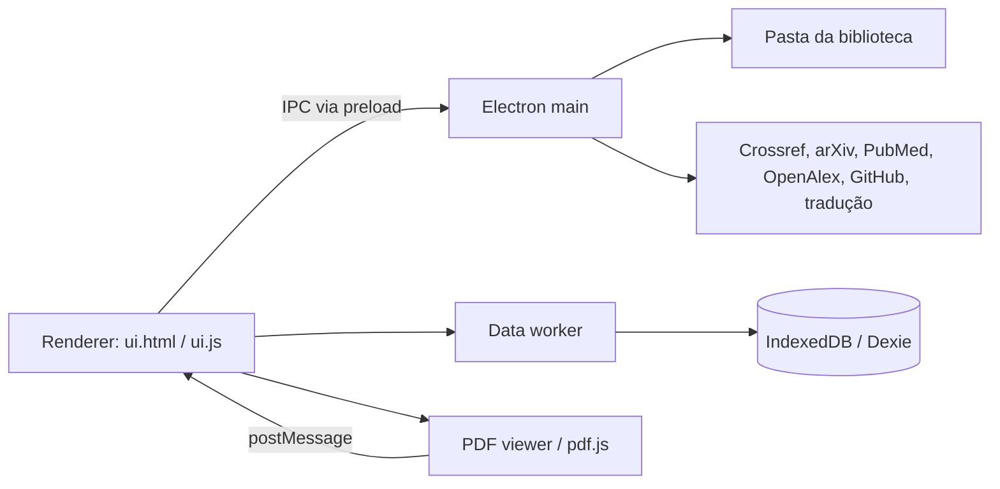

# Desenvolvimento e arquitetura

## Visão geral

O Cite é um aplicativo Electron com interface em HTML, CSS e JavaScript puro. Não há framework de UI. O processo principal concentra acesso ao sistema de arquivos, rede e janelas; o renderer acessa esses recursos apenas pelo `preload.js`, com `contextIsolation` e `sandbox` ativados.



## Processos e responsabilidades

### `main.js`

- cria a janela principal;
- gerencia a pasta de armazenamento e a migração de dados legados;
- executa chamadas de rede que precisam evitar CORS ou proteger credenciais;
- implementa busca online, DOI, metadados, download de PDF e tradução;
- publica a bibliografia no GitHub;
- constrói o menu nativo, com variantes para macOS e Windows.

### `preload.js`

Expõe uma API pequena em `window.cite`, incluindo dados, DOI, tradução, metadados, PDF, backup, anotações, configurações e integrações. O renderer não recebe acesso direto ao Node.js.

### `src/ui.js`

Controla a biblioteca, coleções, etiquetas, filtros, busca online, detalhes, citações, importação/exportação e o ciclo de vida do visualizador. Também faz a ponte por `postMessage` com o iframe do PDF.

### `src/pdf-viewer.js`

Carrega o PDF com pdf.js, renderiza páginas e a camada de texto, controla ferramentas de anotação, comentários, busca interna, zoom, rotação, temas e tradução por seleção.

### `src/data-worker.js` e `src/data/db.js`

O worker mantém o banco IndexedDB com Dexie. As principais coleções são `Library`, `Attachments`, `Collections`, `Notes`, `Changes`, `LocalSettings` e `Files`. O nome interno do banco permanece `refdesk` para preservar bibliotecas antigas.

## Fluxo de dados

1. O usuário escolhe uma pasta de biblioteca no primeiro uso.
2. O `main.js` grava o caminho em `storage.json` e redefine `userData` para essa pasta.
3. O worker abre o IndexedDB e atende chamadas de leitura e escrita.
4. Anexos são salvos em `attachments`, com hash SHA-256 para deduplicação.
5. A interface renderiza a biblioteca a partir do worker.

## Busca online e PDFs

- Crossref usa `offset` para paginação.
- arXiv usa `start`.
- PubMed usa `retstart`.
- Google Acadêmico usa `start`.
- Metadados são normalizados antes de serem anexados à lista de resultados.
- O download de PDF prioriza links de acesso aberto, incluindo OpenAlex, e valida o conteúdo antes de anexar.

## Visualizador de PDF

O visualizador roda em um iframe e usa:

- `pdfjs-dist` para renderização e camada de texto;
- `pdf-text.bundle.js` para extração de texto;
- `pdf.worker.bundle.js` como worker;
- `postMessage` para pedir anotações, atualizar notas, abrir links externos e traduzir.

A seleção de texto gera um menu flutuante com destaque, sublinhado, tachado, comentário, tradução e cópia com número da página.

## Tradução

O trecho selecionado é normalizado, enviado pelo renderer ao processo principal e traduzido por um endpoint configurável. O padrão é o endpoint web do Google Translate. O limite é de 5.000 caracteres por trecho.

Destinos disponíveis na interface:

- Português
- Tetum Dili
- English
- Español

O painel de tradução fecha ao clicar fora e com `Esc`.

## Testes

```bash
npx playwright test
npm run test:data
```

Os testes Playwright usam um servidor mock para Crossref, Google Acadêmico, tradução e outras rotas. Os testes de dados usam `node:test`.

## Build

### macOS

```bash
npx electron-builder --mac dmg
```

### Windows

```bash
npm run build:win
```

O script `scripts/build-windows-installer.js`:

- empacota `dist/win-unpacked` com `electron-builder`;
- usa `scripts/set-windows-resources.mjs` para aplicar ícone e versão com `resedit`;
- compila `scripts/windows-installer.nsi` com `makensis`.

O instalador usa NSIS e quatro telas padrão: boas-vindas, diretório, instalação e conclusão.

## Convenções

- Interface em português; traduções PT/TET em `src/i18n.js`.
- Não adicionar segredos ao repositório.
- Não versionar `node_modules/`, `dist/`, `test-results/` ou artefatos de build.
- Antes de abrir um pull request, execute os testes e o build da plataforma afetada.
