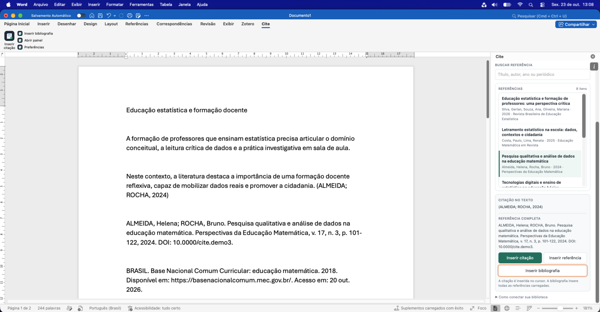

# Add-in do Cite para Word



O add-in adiciona uma aba **Cite** à faixa de opções do Word, ao lado de abas como **Zotero**. Ele lê o `bibliography.json` publicado pelo Cite e insere citações e referências no documento.

## Recursos

- Aba **Cite** com os comandos:
  - **Inserir citação** — busca uma referência e insere a citação no cursor.
  - **Inserir bibliografia** — insere a lista completa ao final do documento.
  - **Abrir painel** — abre a biblioteca para navegar e inserir.
  - **Preferências** — configura a URL da bibliografia e o estilo.
- Estilos ABNT, APA, MLA, Harvard, Vancouver e Chicago.
- Citação no texto no formato autor-data, adequada ao estilo escolhido.
- Busca por título, autor, ano, periódico, DOI ou citação formatada.
- Modo de demonstração com oito referências fictícias.

## Testar localmente no macOS

### 1. Instalar o certificado de desenvolvimento

```bash
npx office-addin-dev-certs install
```

Isso cria um certificado confiável para `https://localhost`.

### 2. Iniciar o painel

Na raiz do projeto:

```bash
npm run word:serve
```

O painel fica disponível em:

```text
https://localhost:3000/taskpane.html?demo=1
```

O servidor usa `integrations/word/manifest.localhost.xml`, que aponta para essa URL e carrega o exemplo automaticamente. Para outra porta:

```bash
PORT=3001 npm run word:serve
```

Nesse caso, ajuste também a porta no `manifest.localhost.xml`.

### 3. Sideload no Word

Copie `manifest.localhost.xml` para a pasta `wef` do Word:

```bash
mkdir -p ~/Library/Containers/com.microsoft.Word/Data/Documents/wef
cp integrations/word/manifest.localhost.xml \
  ~/Library/Containers/com.microsoft.Word/Data/Documents/wef/cite-local.xml
```

Se o macOS bloquear o acesso à pasta do Word, use o Finder:

1. Abra **Ir > Ir para a Pasta**.
2. Digite `~/Library/Containers/com.microsoft.Word/Data/Documents`.
3. Crie a pasta `wef`, se necessário.
4. Copie o `manifest.localhost.xml` para dentro dela.

Feche e reabra o Word.

### 4. Abrir o add-in

1. Abra **Página Inicial > Suplementos**.
2. Em **Suplementos do Desenvolvedor**, clique em **Cite**.
3. A aba **Cite** aparece na faixa de opções e o painel é aberto.
4. Para testar sem sua biblioteca, use **Usar exemplo** ou abra o painel com `?demo=1`.

## Testar no Windows

1. Inicie o servidor com `npm run word:serve` em um Mac ou em um host HTTPS acessível pelo Windows.
2. Ajuste o `manifest.localhost.xml` para o endereço do host, se necessário.
3. Abra **Arquivo > Opções > Central de Confiabilidade > Suplementos Confiáveis** e adicione o catálogo, ou use **Inserir > Meus Suplementos > Carregar Meu Suplemento**.
4. Selecione o manifest e abra o Word.

## Usar a biblioteca real

No Cite:

1. Abra **Ferramentas → Integrações**.
2. Informe o repositório, a branch, a pasta e um token do GitHub com permissão de conteúdo.
3. Clique em **Publicar no GitHub**.

O Cite grava, por exemplo:

```text
cite/bibliography.json
cite/references.bib
```

No painel do Word, cole a URL pública do `bibliography.json`:

```text
https://raw.githubusercontent.com/USUARIO/REPO/main/cite/bibliography.json
```

Clique em **Carregar**. O painel guarda a URL no `localStorage` do add-in. O arquivo precisa ser público e permitir CORS; o `raw.githubusercontent.com` atende a esses requisitos em repositórios públicos. Para repositórios privados, use uma URL assinada ou um proxy com autenticação, porque o add-in não guarda tokens do GitHub.

## Publicar o painel em produção

O Word exige HTTPS. Publique a pasta `integrations/word` em GitHub Pages, Azure Static Web Apps, Netlify, Cloudflare Pages ou outro host estático.

Depois substitua em `manifest.xml`:

- `YOUR_GITHUB_USER`
- `YOUR_REPO`

O `manifest.xml` usa os caminhos:

```text
https://USUARIO.github.io/REPO/integrations/word/taskpane.html
https://USUARIO.github.io/REPO/integrations/word/assets/icon-32.png
https://USUARIO.github.io/REPO/integrations/word/commands.html
```

Se o painel for publicado em outro caminho, ajuste também `SourceLocation`, `IconUrl`, `HighResolutionIconUrl` e os recursos de `VersionOverrides`.

## Arquivos

```text
manifest.xml             manifesto de produção, com placeholders
manifest.localhost.xml   manifesto local para demonstração
taskpane.html/js         painel do Word
commands.html/js         FunctionFile dos comandos de faixa de opções
demo-bibliography.json   bibliografia fictícia para demonstração
assets/                  ícones do add-in
```

## Limitações

- O add-in depende de uma URL pública para a bibliografia.
- O painel precisa estar em HTTPS.
- A citação é inserida como texto, não como campo vinculado. Alterações posteriores no estilo ou na bibliografia não atualizam citações já inseridas.
- O build do add-in não é assinado nem publicado na Office Store.
